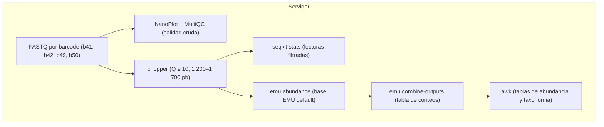
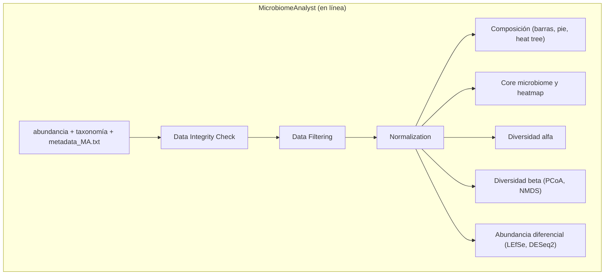
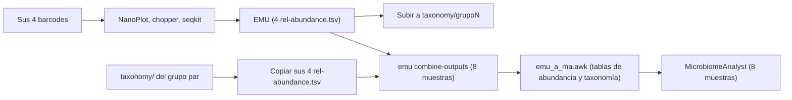

 # Semana 13: Análisis metataxonómico de comunidades bacterianas con datos de secuenciación Nanopore

## Logro de la sesión:

Al finalizar la sesión, el estudiante procesa lecturas Nanopore del gen 16S rRNA completo, asigna taxonomía a nivel de especie con EMU, construye las tablas de abundancia y taxonomía y compara la composición y la diversidad de comunidades bacterianas en MicrobiomeAnalyst: primero con quesos (demo) y luego con muestras de suelo secuenciadas por el curso.

## Estructura de la práctica:

1. Acceso al servidor de cómputo
2. Preparación del entorno y de los datos demo
3. Control de calidad de las lecturas crudas
4. Filtrado por calidad y longitud con chopper
5. Asignación taxonómica con EMU
6. Tablas para MicrobiomeAnalyst
7. Análisis en MicrobiomeAnalyst
8. Análisis de las muestras de su grupo

> **Cómo está organizada esta práctica:** se trabaja en dos partes con los mismos comandos.
>
> - **Parte A, demo (secciones 2 a 7).** Todos los grupos analizan cuatro quesos tipo paria del semestre 2026-1, secuenciados con el gen 16S completo (primers 27F/1492R, ~1 500 pb) en un MinION. Las cuatro muestras forman dos grupos de dos: quesos de **Arequipa** y quesos de **Junín**.
> - **Parte B, sus muestras (sección 8).** Cada grupo procesa sus cuatro barcodes de este semestre (suelos de lomas o rizosfera de arándano) hasta EMU, sube sus clasificaciones a una carpeta compartida y copia las de su grupo par. Con las 8 muestras del par construye las tablas y las analiza en MicrobiomeAnalyst.
>
> En la demo, cada comando se ejecuta por separado, una muestra a la vez, para revisar el resultado de cada muestra antes de pasar a la siguiente. En la sección 8 no se repiten los comandos: se indican los pasos y cada grupo los escribe a partir de la demo.
>
> Muestras demo (`/data/2026_1/metagenomics/metataxonomic/`):
>
> | Muestra | Código | Departamento | Maduración (días) | Inóculo |
> |---|---|---|---|---|
> | b41 | AR01 | Arequipa | 20 | sí |
> | b42 | AR02 | Arequipa | 15 | no |
> | b49 | JU01 | Junín | 15 | sí |
> | b50 | JU02 | Junín | 30 | sí |
>
> La metadata (`metadata_queso_demo_MA.txt`) y el script de conversión de EMU a MicrobiomeAnalyst (`emu_a_ma.awk`) están en `/data/2026_2/metagenomics/metataxonomic/data/`; se copian de allí en las secciones 2 y 6.
>
> Con dos muestras por grupo ninguna prueba estadística puede dar p < 0,05. La demo sirve para aprender el flujo y leer los gráficos; las conclusiones se discuten como tendencias.

## Flujo de trabajo:

### Procesamiento de las lecturas en el servidor (secciones 2 a 6):



### Análisis en línea (sección 7):



## Programas requeridos:

### Programas de acceso al servidor:

PuTTY v0.79 https://www.chiark.greenend.org.uk/~sgtatham/putty/latest.html
   - **Descripción:** cliente SSH para establecer conexiones de línea de comandos con el servidor.

WinSCP v6.1 https://winscp.net/eng/download.php
   - **Descripción:** cliente SFTP con interfaz gráfica para transferir archivos entre su computadora y el servidor. En esta práctica se usa para descargar los reportes de calidad y los archivos que se cargan en MicrobiomeAnalyst.

### Programas bioinformáticos:

NanoPlot https://github.com/wdecoster/NanoPlot
   - **Descripción:** genera gráficos y estadísticas de lecturas largas: distribución de longitudes, calidad media y relación entre ambas. Se usa para ver el estado de las lecturas antes de filtrarlas.

MultiQC https://multiqc.info
   - **Descripción:** reúne en un solo reporte HTML los resultados de NanoPlot de todas las muestras, para compararlas lado a lado.

seqkit https://bioinf.shenwei.me/seqkit/
   - **Descripción:** conjunto de utilidades para archivos FASTA/FASTQ. Con `seqkit stats` se obtiene el número de lecturas, la longitud media, el N50 y la calidad media de cada archivo.

chopper https://github.com/wdecoster/chopper
   - **Descripción:** filtra lecturas Nanopore por calidad media y por longitud. Es el sucesor de NanoFilt, del mismo autor; está escrito en Rust y es bastante más rápido.

EMU https://github.com/treangenlab/emu
   - **Descripción:** EMU (*Expectation-Maximization algorithm for Microbial community profiling*) alinea cada lectura con minimap2 contra una base de secuencias 16S y estima, con un algoritmo de esperanza-maximización, la abundancia de cada especie. Fue diseñado para lecturas largas con errores, como las de Nanopore, y resuelve hasta especie con el gen 16S completo.

### Bases de datos:

Base EMU default (rrnDB v5.6 + NCBI 16S RefSeq)
   - **Descripción:** base que distribuye EMU. Une las secuencias del operón ribosomal de rrnDB con las 16S de RefSeq del NCBI y usa la taxonomía del NCBI de la fecha en que se construyó la base. Por eso los filos aparecen con los nombres anteriores a la reforma de 2021 (*Firmicutes*, *Proteobacteria*, *Actinobacteria*, *Bacteroidetes*) y no con los actuales (*Bacillota*, *Pseudomonadota*, *Actinomycetota*, *Bacteroidota*). Solo contiene bacterias y arqueas: no hay cloroplastos ni mitocondrias que eliminar.

### Herramientas bioinformáticas en línea:

MicrobiomeAnalyst v2.0 https://www.microbiomeanalyst.ca/
   - **Descripción:** plataforma web para el análisis estadístico y visual de datos de microbioma. Su módulo *Marker Data Profiling* (MDP) recibe una tabla de abundancias con taxonomía y la metadata, y calcula composición, microbioma núcleo, diversidad alfa y beta, y abundancia diferencial.

## Metodología:

## 1. Acceso al servidor de cómputo:

### Abrir el programa PuTTY, colocar el hostname ( 10.142.250.66 ) y port ( 22 ), y dar clic en Open:


**Figura 1.** Ventana de configuración de PuTTY. En *Host Name* se coloca la dirección IP del servidor y en *Port* el puerto 22 (SSH); el tipo de conexión debe ser SSH.

> **Comentario (figura 1):** antes de abrir la sesión, vaya a **Connection** y en *Seconds between keepalives* escriba **30**. Así la conexión no se corta por inactividad mientras corre EMU. Si la conexión se cae a mitad de un comando, ese comando se interrumpe y hay que volver a ejecutarlo.

### En la terminal abierta, escribir su usuario y contraseña correspondiente para tener acceso al servidor de cómputo:


**Figura 2.** Terminal de PuTTY al iniciar la sesión. Al escribir la contraseña no se muestran caracteres en pantalla; es el comportamiento normal.

### Abrir el programa WinSCP, colocar el hostname ( 10.142.250.66 ) y port ( 22 ), escribir su usuario y contraseña correspondiente para tener acceso al servidor de cómputo, y hacer clic en Login:


**Figura 3.** Ventana de inicio de sesión de WinSCP, con el protocolo SFTP, la dirección del servidor, el puerto 22, el usuario y la contraseña.


**Figura 4.** Sesión de WinSCP abierta. El panel izquierdo muestra las carpetas de su computadora y el derecho, las del servidor; los archivos se transfieren arrastrándolos de un panel al otro.

### Uso compartido del servidor

El servidor tiene 64 hilos y 180 GB de RAM, y lo usan **6 grupos a la vez**. Cada grupo usa como máximo **10 hilos**. No use valores mayores que los indicados en los comandos.

| Sección | Paso | Tiempo aproximado (10 hilos, 4 muestras) |
|---|---|---|
| 3 | NanoPlot y MultiQC | 5–10 min |
| 4 | chopper y seqkit | 2–5 min |
| 5 | EMU | 10–30 min |
| 6 | Tablas para MicrobiomeAnalyst | < 1 min |

> **Comentario:** los tiempos dependen de la carga del servidor. EMU es el paso más lento: alinea cada lectura contra toda la base de referencia.

## 2. Preparación del entorno y de los datos demo

### Crear la estructura de carpetas

El análisis de la demo se hace en la carpeta `demo/`, y el de sus muestras (sección 8), en `trabajo/`. Las dos carpetas están en el mismo nivel, dentro de `~/metataxonomic/nanopore/`, y tienen la misma estructura interna:

```bash
~/metataxonomic/nanopore/
├── demo/          # Parte A: muestras demo (b41, b42, b49, b50)
│   ├── 01_qc/
│   ├── 02_chopper/
│   ├── 03_emu/
│   └── 04_ma/
└── trabajo/       # Parte B: muestras de su grupo y de su grupo par (sección 8)
    ├── 01_qc/
    ├── 02_chopper/
    ├── 03_emu/
    └── 04_ma/
```

```bash
mkdir -p ~/metataxonomic/nanopore/demo/01_qc/nanoplot_crudo ~/metataxonomic/nanopore/demo/02_chopper ~/metataxonomic/nanopore/demo/03_emu/threshold ~/metataxonomic/nanopore/demo/03_emu/unclassified_reads ~/metataxonomic/nanopore/demo/04_ma
```

> **Comentario:**
> - `mkdir -p` crea todas las carpetas indicadas y las intermedias que falten (`metataxonomic`, `nanopore`, `demo`). Si alguna ya existe, por ejemplo `~/metataxonomic` desde la semana 12, no la toca y no muestra error.
> - Cada carpeta numerada guarda la salida de un paso: `01_qc`, control de calidad; `02_chopper`, lecturas filtradas; `03_emu`, clasificación taxonómica; `04_ma`, las tablas para MicrobiomeAnalyst. La numeración sigue el orden del análisis.

```bash
cd ~/metataxonomic/nanopore/demo
```

> **Comentario:** entra a la carpeta de la demo. Todos los comandos de las secciones 2 a 6 se ejecutan aquí, con rutas relativas a esta carpeta.

```bash
find ~/metataxonomic/nanopore/demo -type d | sort

/home/<usuario>/metataxonomic/nanopore/demo
/home/<usuario>/metataxonomic/nanopore/demo/01_qc
/home/<usuario>/metataxonomic/nanopore/demo/01_qc/nanoplot_crudo
/home/<usuario>/metataxonomic/nanopore/demo/02_chopper
/home/<usuario>/metataxonomic/nanopore/demo/03_emu
/home/<usuario>/metataxonomic/nanopore/demo/03_emu/threshold
/home/<usuario>/metataxonomic/nanopore/demo/03_emu/unclassified_reads
/home/<usuario>/metataxonomic/nanopore/demo/04_ma
```

> **Comentario:**
> - **Comando:** `find ... -type d` lista todas las carpetas (*directories*) que hay dentro de `demo`; `sort` las ordena alfabéticamente.
> - **Resultado:** las ocho carpetas de la estructura. `<usuario>` será su nombre de usuario.

### Verificar los archivos de entrada

```bash
ls -lh /data/2026_1/metagenomics/metataxonomic/b41.fastq.gz /data/2026_1/metagenomics/metataxonomic/b42.fastq.gz /data/2026_1/metagenomics/metataxonomic/b49.fastq.gz /data/2026_1/metagenomics/metataxonomic/b50.fastq.gz

-rw-rw-r-- 1 fguzman fguzman 5,4M nov 20 18:22 /data/2026_1/metagenomics/metataxonomic/b41.fastq.gz
-rw-rw-r-- 1 fguzman fguzman 5,9M nov 20 18:22 /data/2026_1/metagenomics/metataxonomic/b42.fastq.gz
-rw-rw-r-- 1 fguzman fguzman 5,4M nov 20 18:22 /data/2026_1/metagenomics/metataxonomic/b49.fastq.gz
-rw-rw-r-- 1 fguzman fguzman 4,8M nov 20 18:22 /data/2026_1/metagenomics/metataxonomic/b50.fastq.gz
```

> **Comentario:**
> - **Comando:** `ls -lh` lista los archivos indicados con su tamaño en un formato legible (K, M, G).
> - **Resultado:** los cuatro archivos existen. Si aparece `No such file or directory`, revise la ruta.

### Copiar la metadata para MicrobiomeAnalyst

```bash
cp /data/2026_2/metagenomics/metataxonomic/data/metadata_queso_demo_MA.txt metadata_MA.txt
```

> **Comentario:** copia la metadata de la demo a la carpeta actual con el nombre `metadata_MA.txt`. El archivo ya está preparado con tabuladores: si se escribe pegando texto desde PuTTY en `nano`, los tabuladores suelen convertirse en espacios y MicrobiomeAnalyst no lo lee.

```bash
cat -A metadata_MA.txt

#NAME^Icodigo^Idepartamento^Imaduracion^Iinoculo$
b41^IAR01^IArequipa^I20^Isi$
b42^IAR02^IArequipa^I15^Ino$
b49^IJU01^IJunin^I15^Isi$
b50^IJU02^IJunin^I30^Isi$
```

> **Comentario:**
> - **Comando:** `cat -A` muestra los caracteres invisibles: cada tabulador aparece como `^I` y cada fin de línea como `$`.
> - **Resultado:** cinco columnas separadas por tabuladores. MicrobiomeAnalyst exige que la primera se llame `#NAME` y que sus valores coincidan exactamente con los nombres de las muestras en la tabla de abundancias (b41, b42...). La variable que se compara es `departamento`; `maduracion` e `inoculo` sirven para explorar otros patrones en los gráficos.

## 3. Control de calidad de las lecturas crudas

```bash
conda activate quality
```

> **Comentario:** activa el entorno donde están NanoPlot, MultiQC, chopper y seqkit. El nombre del entorno aparece entre paréntesis al inicio de la línea de comandos.

### Reporte de NanoPlot de la muestra b41

```bash
NanoPlot -t 10 --fastq /data/2026_1/metagenomics/metataxonomic/b41.fastq.gz --only-report -p b41_ -o 01_qc/nanoplot_crudo
```

> **Comentario:**
> - `-t 10`: número de hilos.
> - `--fastq`: archivo de entrada; NanoPlot lee directamente el FASTQ comprimido.
> - `--only-report`: genera el reporte HTML y el archivo de estadísticas, sin guardar cada gráfico por separado.
> - `-p b41_`: prefijo de los archivos de salida (`b41_NanoPlot-report.html`, `b41_NanoStats.txt`). Sin prefijo, cada muestra sobrescribiría a la anterior en la misma carpeta.
> - `-o 01_qc/nanoplot_crudo`: carpeta de salida.

### Reporte de NanoPlot de la muestra b42

```bash
NanoPlot -t 10 --fastq /data/2026_1/metagenomics/metataxonomic/b42.fastq.gz --only-report -p b42_ -o 01_qc/nanoplot_crudo
```

> **Comentario:** el mismo comando; cambian el archivo de entrada y el prefijo.

### Reporte de NanoPlot de la muestra b49

```bash
NanoPlot -t 10 --fastq /data/2026_1/metagenomics/metataxonomic/b49.fastq.gz --only-report -p b49_ -o 01_qc/nanoplot_crudo
```

### Reporte de NanoPlot de la muestra b50

```bash
NanoPlot -t 10 --fastq /data/2026_1/metagenomics/metataxonomic/b50.fastq.gz --only-report -p b50_ -o 01_qc/nanoplot_crudo
```

```bash
ls 01_qc/nanoplot_crudo

b41_NanoPlot-report.html  b42_NanoPlot-report.html  b49_NanoPlot-report.html  b50_NanoPlot-report.html
b41_NanoStats.txt         b42_NanoStats.txt         b49_NanoStats.txt         b50_NanoStats.txt
...
```

> **Comentario:** hay un reporte HTML y un archivo de estadísticas por muestra. Puede haber además archivos de registro (`.log`).

### Visualizar el reporte de texto de NanoPlot

NanoPlot guarda las estadísticas de cada muestra en un archivo de texto (`_NanoStats.txt`). Ábralo directamente en la terminal, una muestra a la vez.

```bash
cat 01_qc/nanoplot_crudo/b41_NanoStats.txt

General summary:         
Mean read length:              1,357.7
Mean read quality:                15.8
Median read length:            1,491.0
Median read quality:              21.1
Number of reads:               5,598.0
Read length N50:               1,496.0
STDEV read length:               435.6
Total bases:               7,600,405.0
Number, percentage and megabases of reads above quality cutoffs
>Q10:   5206 (93.0%) 7.0Mb
>Q15:   4458 (79.6%) 6.0Mb
>Q20:   3160 (56.4%) 4.1Mb
>Q25:   1389 (24.8%) 1.7Mb
>Q30:   384 (6.9%) 0.4Mb
Top 5 highest mean basecall quality scores and their read lengths
1:      45.6 (45)
2:      44.1 (132)
3:      43.8 (88)
4:      43.3 (338)
5:      42.3 (212)
Top 5 longest reads and their mean basecall quality score
1:      4470 (9.8)
2:      4406 (19.5)
3:      3327 (20.9)
4:      3094 (22.7)
5:      3078 (19.0)
```

> **Comentario:**
> - **Comando:** `cat` muestra en pantalla el contenido completo del archivo.
> - **Resultado:** el reporte tiene tres bloques.
>   - *General summary*: `Number of reads`, número de lecturas crudas; `Mean read length` y `Median read length`, longitud media y mediana; `Read length N50`, longitud tal que las lecturas de esa longitud o mayores suman la mitad de las bases; `Mean read quality` y `Median read quality`, calidad Phred media y mediana; `STDEV read length`, dispersión de las longitudes; `Total bases`, bases secuenciadas.
>   - *Reads above quality cutoffs*: número, porcentaje y megabases de lecturas que superan Q10, Q15, Q20, Q25 y Q30. El porcentaje >Q10 anticipa cuántas lecturas conservará chopper con `-q 10`.
>   - *Top 5*: las cinco lecturas de mayor calidad y las cinco más largas. Si las más largas miden varios kb, la muestra tiene concatémeros, que chopper eliminará con `--maxlength 1700`.
> - Si la media de longitud es mucho mayor que la mediana, hay pocas lecturas muy largas que arrastran el promedio. Para el 16S completo, la mediana debe estar cerca de 1 500 pb.

```bash
cat 01_qc/nanoplot_crudo/b42_NanoStats.txt
```

```bash
cat 01_qc/nanoplot_crudo/b49_NanoStats.txt
```

```bash
cat 01_qc/nanoplot_crudo/b50_NanoStats.txt
```

> **Comentario:** el mismo reporte para las otras tres muestras. Anote de cada una el número de lecturas, la mediana de longitud, el N50, la calidad media y el porcentaje >Q10: son los datos crudos de la tabla de lecturas de la bitácora.

### Reporte conjunto con MultiQC

```bash
multiqc 01_qc/nanoplot_crudo -o 01_qc/multiqc_crudo -n queso_demo_multiqc_crudo
```

> **Comentario:**
> - `01_qc/nanoplot_crudo`: carpeta donde MultiQC busca resultados. Reconoce los archivos `*NanoStats.txt`.
> - `-o`: carpeta de salida.
> - `-n`: nombre del reporte (`queso_demo_multiqc_crudo.html`), que reúne las cuatro muestras en una sola tabla y en gráficos comparables.

### Descargar con WinSCP la carpeta `01_qc` y abrir los reportes en el navegador

> **Punto de control:** En el reporte HTML de cada muestra, ubique el histograma de longitudes. ¿Dónde está el pico principal y por qué cae cerca de 1 500 pb? ¿Hay lecturas mucho más cortas o mucho más largas? ¿Qué porcentaje de lecturas supera Q10? Ese porcentaje anticipa cuántas lecturas conservará chopper.

## 4. Filtrado por calidad y longitud con chopper

### Filtrar la muestra b41

```bash
chopper -i /data/2026_1/metagenomics/metataxonomic/b41.fastq.gz -q 10 -l 1200 --maxlength 1700 --threads 10 | gzip > 02_chopper/b41.fastq.gz

Kept 4042 reads out of 5598 reads
```

> **Comentario (comando):**
> - `-i`: archivo de entrada. chopper lee directamente el FASTQ comprimido (`.fastq.gz`); no hace falta descomprimirlo antes.
> - `-q 10`: conserva las lecturas con calidad media ≥ Q10, es decir, con una tasa de error media de 10 % o menos.
> - `-l 1200 --maxlength 1700`: conserva las lecturas de 1 200 a 1 700 pb. El amplicón 27F–1492R mide ~1 500 pb; las lecturas más cortas son amplicones truncados y las más largas, concatémeros o quimeras.
> - `--threads 10`: hilos.
> - `| gzip > 02_chopper/b41.fastq.gz`: chopper escribe las lecturas que pasan el filtro en la salida estándar, sin comprimir. El símbolo `|` (tubería) las envía a `gzip`, que las comprime, y `>` las guarda en la carpeta `02_chopper`.
>
> **Comentario (resultado):** al terminar, chopper informa cuántas lecturas conservó de cuántas recibió.

### Filtrar la muestra b42

```bash
chopper -i /data/2026_1/metagenomics/metataxonomic/b42.fastq.gz -q 10 -l 1200 --maxlength 1700 --threads 10 | gzip > 02_chopper/b42.fastq.gz

Kept 4723 reads out of 6758 reads
```

### Filtrar la muestra b49

```bash
chopper -i /data/2026_1/metagenomics/metataxonomic/b49.fastq.gz -q 10 -l 1200 --maxlength 1700 --threads 10 | gzip > 02_chopper/b49.fastq.gz

Kept 3481 reads out of 5121 reads
```

### Filtrar la muestra b50

```bash
chopper -i /data/2026_1/metagenomics/metataxonomic/b50.fastq.gz -q 10 -l 1200 --maxlength 1700 --threads 10 | gzip > 02_chopper/b50.fastq.gz

Kept 3163 reads out of 4983 reads
```

### Estadísticas de las lecturas filtradas con seqkit

```bash
seqkit stats -a -T -j 10 02_chopper/*.fastq.gz > 01_qc/seqkit_filtrado.tsv
```

> **Comentario:**
> - `02_chopper/*.fastq.gz`: el asterisco incluye todos los FASTQ de la carpeta, es decir, las cuatro muestras filtradas.
> - `-a`: estadísticas completas (N50, cuartiles, calidad media).
> - `-T`: salida separada por tabuladores.
> - `-j 10`: hilos.
> - `> 01_qc/seqkit_filtrado.tsv`: guarda la tabla en un archivo.

```bash
awk -F'\t' -v OFS='\t' 'NR==1{for(i=1;i<=NF;i++) c[$i]=i} {sub(/.*\//,"",$1); print $1, $c["num_seqs"], $c["avg_len"], $c["min_len"], $c["max_len"], $c["N50"], $c["AvgQual"]}' 01_qc/seqkit_filtrado.tsv | column -t

file          num_seqs  avg_len  min_len  max_len  N50   AvgQual
b41.fastq.gz  4042      1465.4   1200     1700     1497  18.03
b42.fastq.gz  4723      1438.2   1201     1699     1459  18.24
b49.fastq.gz  3481      1453.2   1200     1693     1473  18.14
b50.fastq.gz  3163      1456.0   1200     1692     1495  18.06
```

> **Comentario:**
> - **Comando:** `awk` lee la línea 1 (`NR==1`) y guarda la posición de cada columna según su nombre; así funciona aunque otra versión de seqkit cambie el orden de las columnas. `sub(/.*\//,"",$1)` borra la ruta y deja solo el nombre del archivo. `column -t` alinea las columnas.
> - **Resultado:** `num_seqs` es el número de lecturas filtradas. `min_len` y `max_len` deben quedar dentro de 1 200–1 700 pb, y `AvgQual` debe ser mayor que la `Mean read quality` de NanoPlot.

> **Punto de control:** Con el número de lecturas del reporte `_NanoStats.txt` (crudas) y de seqkit (filtradas), calcule el porcentaje de lecturas que conservó cada muestra. ¿Qué muestra perdió más? Revise su histograma de NanoPlot: ¿la pérdida se debió sobre todo a la longitud o a la calidad?

## 5. Asignación taxonómica con EMU

```bash
conda activate metataxonomic

emu --version
```

> **Comentario:** activa el entorno donde está instalado EMU y muestra su versión. Anótela para la bitácora.

```bash
ls /data/db/emu/emu/

species_taxid.fasta  taxonomy.tsv
```

> **Comentario:** la base EMU default tiene dos archivos: `species_taxid.fasta`, con las secuencias de referencia (cada encabezado empieza con el identificador taxonómico del NCBI, *tax_id*), y `taxonomy.tsv`, con el linaje de cada tax_id.

### Clasificar la muestra b41

```bash
emu abundance --type map-ont --db /data/db/emu/emu/ --threads 10 --keep-counts --output-unclassified --output-dir 03_emu --output-basename b41 02_chopper/b41.fastq.gz

[M::mm_idx_gen::1.566*1.28] collected minimizers
[M::mm_idx_gen::1.693*1.91] sorted minimizers
[M::main::1.701*1.90] loaded/built the index for 49243 target sequence(s)
[M::mm_mapopt_update::1.733*1.89] mid_occ = 14113
[M::mm_idx_stat] kmer size: 15; skip: 10; is_hpc: 0; #seq: 49243
[M::mm_idx_stat::1.750*1.88] distinct minimizers: 462637 (45.14% are singletons); average occurrences: 28.757; average spacing: 5.572; total length: 74133434
[M::worker_pipeline::159.771*9.88] mapped 4042 sequences
[M::main] Version: 2.28-r1209
[M::main] CMD: minimap2 -ax map-ont -t 10 -N 50 -p .9 -K 500000000 -o 03_emu/b41_emu_alignments.sam /data/db/emu/emu/species_taxid.fasta 02_chopper/b41.fastq.gz
[M::main] Real time: 159.842 sec; CPU: 1578.753 sec; Peak RSS: 1.273 GB
Unmapped read count: 0
Filtered read count: 0
Filtered 0 alignments outside aligned query length bounds (min_align_len=0, max_align_len=2000).
Filtered 0 alignments below min-pid (0%) threshold.
Mapped read count: 4042
Number of EM iterations: 21
Unclassified mapped read count: 20
```

> **Comentario (comando):**
> - `--type map-ont`: preset de minimap2 para lecturas Nanopore.
> - `--db`: carpeta de la base de referencia.
> - `--threads 10`: hilos.
> - `--keep-counts`: añade la columna `estimated counts`, con el número de lecturas estimado para cada taxón. MicrobiomeAnalyst necesita conteos, no porcentajes.
> - `--output-unclassified`: guarda en FASTQ las lecturas que EMU no asigna a ningún taxón, en tres archivos: las que no se alinearon (`_unmapped.fastq`), las que se alinearon pero EMU descartó por sus filtros de alineamiento (`_filtered_mapped.fastq`) y las que se alinearon a taxones eliminados por el umbral de abundancia (`_unclassified_mapped.fastq`).
> - `--output-dir 03_emu`: carpeta de salida.
> - `--output-basename b41`: prefijo de los archivos de salida (`b41_rel-abundance.tsv`). Sin esta opción, EMU usa el nombre completo del FASTQ, y ese nombre pasaría a ser el de la muestra en la tabla final.
> - `02_chopper/b41.fastq.gz`: lecturas filtradas de la muestra (último argumento).
>
> **Comentario (algoritmo):** EMU alinea cada lectura con minimap2 y guarda todas sus alineaciones posibles, no solo la mejor. Luego estima, de forma iterativa (esperanza-maximización), qué abundancia de cada especie explica mejor el conjunto de alineaciones. Al final descarta los taxones con abundancia menor que el umbral (`--min-abundance`, 0,0001 por defecto) y reparte sus lecturas entre los demás.

> **Comentario (resultado):** EMU muestra los mensajes en pantalla mientras trabaja; el *prompt* vuelve cuando termina (unos minutos por muestra). La salida tiene dos partes.
>
> *Mensajes de minimap2* (líneas que empiezan con `[M::`), el alineador que EMU ejecuta internamente:
> - `loaded/built the index for 49243 target sequence(s)`: minimap2 indexó las 49 243 secuencias 16S de la base EMU default. `kmer size: 15` es el largo de las semillas (*minimizers*) con que busca coincidencias, y `total length: 74133434`, las bases de la base de referencia (~74 Mb).
> - `mapped ... sequences`: número de lecturas que minimap2 procesó; debe ser igual al que dejó chopper (`num_seqs` de seqkit).
> - `CMD: minimap2 -ax map-ont -t 10 -N 50 -p .9 ...`: el comando exacto que lanzó EMU. `-a` escribe el alineamiento en formato SAM; `-N 50` conserva hasta 50 alineamientos secundarios por lectura, y `-p .9` solo los que tienen un puntaje de al menos 90 % del mejor. EMU necesita esos alineamientos alternativos: una lectura de 16S suele parecerse a varias especies del mismo género. El SAM (`b41_emu_alignments.sam`) es temporal y EMU lo borra al terminar.
> - `Real time`, `CPU` y `Peak RSS`: tiempo real que tardó, tiempo total de CPU y memoria RAM máxima usada. El tiempo de CPU es cerca de 10 veces el real porque los 10 hilos trabajaron en paralelo.
>
> *Resumen de EMU* (últimas líneas):
> - `Unmapped read count: 0`: lecturas sin ningún alineamiento contra la base. Se guardan en `b41_unmapped.fastq`.
> - `Filtered read count`, `Filtered 0 alignments outside aligned query length bounds` y `Filtered 0 alignments below min-pid (0%)`: EMU puede descartar alineamientos por su longitud o por su porcentaje de identidad. Con los valores por defecto estos filtros no se aplican, por eso todos son 0 y `b41_filtered_mapped.fastq` queda vacío.
> - `Mapped read count`: lecturas con al menos un alineamiento, que entran al algoritmo EM. Junto con `Unmapped read count`, debe sumar las lecturas de `mapped ... sequences`. EMU cuenta las lecturas por su nombre (ID); si un FASTQ tuviera lecturas repetidas, cada nombre se contaría una sola vez y este número quedaría por debajo de lo esperado.
> - `Number of EM iterations`: vueltas que dio el algoritmo de esperanza-maximización hasta que las abundancias dejaron de cambiar (convergencia).
> - `Unclassified mapped read count`: lecturas que se alinearon, pero solo con especies que al final quedaron por debajo del umbral de abundancia (`--min-abundance`, 0,0001). No se asignan a ningún taxón y se guardan en `b41_unclassified_mapped.fastq`.
>
> Si EMU falla (por ejemplo, por falta de memoria o una ruta mal escrita), el error aparece al final de esta salida. Revísela antes de pasar a la siguiente muestra.

### Clasificar la muestra b42

```bash
emu abundance --type map-ont --db /data/db/emu/emu/ --threads 10 --keep-counts --output-unclassified --output-dir 03_emu --output-basename b42 02_chopper/b42.fastq.gz
```

> **Comentario:** el mismo comando; cambian el prefijo y el archivo de entrada. Revise en la salida las líneas `Mapped read count` y `Unclassified mapped read count` antes de pasar a la siguiente muestra.

### Clasificar la muestra b49

```bash
emu abundance --type map-ont --db /data/db/emu/emu/ --threads 10 --keep-counts --output-unclassified --output-dir 03_emu --output-basename b49 02_chopper/b49.fastq.gz
```

### Clasificar la muestra b50

```bash
emu abundance --type map-ont --db /data/db/emu/emu/ --threads 10 --keep-counts --output-unclassified --output-dir 03_emu --output-basename b50 02_chopper/b50.fastq.gz
```

### Revisar la salida de una muestra

```bash
ls -lh 03_emu

-rw-rw-r-- 1 fguzman fguzman    0 nov 20 18:30 b41_filtered_mapped.fastq
-rw-rw-r-- 1 fguzman fguzman 1,2K nov 20 18:30 b41_rel-abundance.tsv
-rw-rw-r-- 1 fguzman fguzman  58K nov 20 18:30 b41_unclassified_mapped.fastq
-rw-rw-r-- 1 fguzman fguzman    0 nov 20 18:30 b41_unmapped.fastq
-rw-rw-r-- 1 fguzman fguzman    0 nov 20 18:31 b42_filtered_mapped.fastq
-rw-rw-r-- 1 fguzman fguzman  562 nov 20 18:31 b42_rel-abundance.tsv
-rw-rw-r-- 1 fguzman fguzman  23K nov 20 18:31 b42_unclassified_mapped.fastq
-rw-rw-r-- 1 fguzman fguzman    0 nov 20 18:31 b42_unmapped.fastq
-rw-rw-r-- 1 fguzman fguzman    0 nov 20 18:32 b49_filtered_mapped.fastq
-rw-rw-r-- 1 fguzman fguzman 3,5K nov 20 18:32 b49_rel-abundance.tsv
-rw-rw-r-- 1 fguzman fguzman 200K nov 20 18:32 b49_unclassified_mapped.fastq
-rw-rw-r-- 1 fguzman fguzman    0 nov 20 18:32 b49_unmapped.fastq
-rw-rw-r-- 1 fguzman fguzman    0 nov 20 18:34 b50_filtered_mapped.fastq
-rw-rw-r-- 1 fguzman fguzman  919 nov 20 18:34 b50_rel-abundance.tsv
-rw-rw-r-- 1 fguzman fguzman 105K nov 20 18:34 b50_unclassified_mapped.fastq
-rw-rw-r-- 1 fguzman fguzman    0 nov 20 18:34 b50_unmapped.fastq
drwxrwxr-x 2 fguzman fguzman 4,0K nov 20 17:49 threshold
drwxrwxr-x 2 fguzman fguzman 4,0K nov 20 17:49 unclassified_reads
```

> **Comentario:**
> - **Comando:** `ls -lh` lista el contenido de la carpeta con el tamaño de cada archivo.
> - **Resultado:** por cada muestra hay una tabla de abundancias (`_rel-abundance.tsv`) y los tres FASTQ de lecturas no asignadas que genera `--output-unclassified`. Los archivos de 0 bytes están vacíos: en estas muestras ninguna lectura quedó sin alinear (`_unmapped`) ni fue descartada por los filtros (`_filtered_mapped`). Solo `_unclassified_mapped` tiene lecturas: las que se alinearon a especies eliminadas por el umbral de abundancia. Su tamaño crece con el número de lecturas: b49, la muestra con más especies raras, tiene el más grande.

```bash
head -n 10 03_emu/b41_rel-abundance.tsv | cut -f1-4

tax_id  abundance       species genus
1358    0.14104950582941433     Lactococcus lactis      Lactococcus
1304    0.004133538438862973    Streptococcus salivarius        Streptococcus
1308    0.41563266568943064     Streptococcus thermophilus      Streptococcus
1296    0.256990072401691       Staphylococcus sciuri   Staphylococcus
51665   0.13353115022733061     Aerococcus urinaeequi   Aerococcus
29385   0.04866306741327068     Staphylococcus saprophyticus    Staphylococcus
unmapped        0.0
mapped_filtered 0.0
mapped_unclassified     0.0
```

> **Comentario:**
> - **Comando:** `head -n 10` muestra el encabezado y los taxones; `cut -f1-4` muestra solo las cuatro primeras columnas.
> - **Resultado:** `tax_id`, identificador del NCBI; `abundance`, abundancia relativa (fracción entre 0 y 1); y `species`, `genus`, etc., el linaje. Más a la derecha está `estimated counts`. En b41, *Streptococcus thermophilus* (41,6 %) y *Lactococcus lactis* (14,1 %), dos bacterias de cultivo iniciador, conviven con *Staphylococcus sciuri* (25,7 %) y *Aerococcus urinaeequi* (13,4 %).
> - Las tres últimas filas no son taxones: `unmapped`, `mapped_filtered` y `mapped_unclassified` resumen las lecturas no asignadas. Su `abundance` es 0 porque la abundancia relativa se calcula solo sobre las lecturas clasificadas; el número de lecturas de cada una aparece en la columna `estimated counts` (por ejemplo, 20 en `mapped_unclassified`, el mismo valor de `Unclassified mapped read count`).

### Ordenar la salida

```bash
mv 03_emu/*_rel-abundance-threshold-*.tsv 03_emu/threshold/ 2>/dev/null

mv 03_emu/*_unmapped.fastq 03_emu/*_filtered_mapped.fastq 03_emu/*_unclassified_mapped.fastq 03_emu/unclassified_reads/

gzip 03_emu/unclassified_reads/*.fastq
```

> **Comentario:**
> - Las carpetas `threshold/` y `unclassified_reads/` se crearon en la sección 2.
> - `emu combine-outputs` une todos los archivos de la carpeta cuyo nombre contiene `rel-abundance`. Si EMU escribió tablas con umbral (`_rel-abundance-threshold-*.tsv`), se tratarían como muestras extra; por eso se mueven a `threshold/`. `2>/dev/null` oculta el mensaje de error si no existen.
> - Los tres FASTQ de lecturas no asignadas se mueven a `unclassified_reads/` y se comprimen con `gzip`. Así en `03_emu` quedan solo las tablas.

### Cuantificar las lecturas no clasificadas

```bash
conda activate quality

seqkit stats -T 03_emu/unclassified_reads/*.fastq.gz | cut -f1,4 | column -t

file                                                        num_seqs
03_emu/unclassified_reads/b41_unclassified_mapped.fastq.gz  20
03_emu/unclassified_reads/b41_unmapped.fastq.gz             0
03_emu/unclassified_reads/b42_unclassified_mapped.fastq.gz  8
03_emu/unclassified_reads/b42_unmapped.fastq.gz             0
03_emu/unclassified_reads/b49_unclassified_mapped.fastq.gz  69
03_emu/unclassified_reads/b49_unmapped.fastq.gz             0
03_emu/unclassified_reads/b50_unclassified_mapped.fastq.gz  36
03_emu/unclassified_reads/b50_unmapped.fastq.gz             0
```

> **Comentario:**
> - **Comando:** seqkit está en el entorno `quality`, así que se activa un momento. `*.fastq.gz` incluye los tres tipos de archivo de las cuatro muestras; `cut -f1,4` deja solo el nombre del archivo y el número de lecturas.
> - **Resultado:** ninguna lectura quedó sin alinear (`_unmapped`) ni fue filtrada (`_filtered_mapped`). Las únicas lecturas no asignadas son las de `_unclassified_mapped`: entre 8 (b42) y 69 (b49), menos del 2 % de las lecturas filtradas de cada muestra. La base EMU default tiene bien representadas a las bacterias lácticas, así que casi todas las lecturas de queso encuentran una referencia. b49 tiene más lecturas no asignadas porque su comunidad es más diversa y tiene más especies raras, que caen por debajo del umbral de abundancia.

```bash
conda activate metataxonomic
```

> **Comentario:** vuelve al entorno de EMU para el paso siguiente.

### Combinar las muestras en una sola tabla

```bash
cd 03_emu

emu combine-outputs . tax_id --counts

emu combine-outputs . tax_id

emu combine-outputs . genus

cd ..
```

> **Comentario:**
> - `combine-outputs <carpeta> <rango>`: une las tablas de todas las muestras en una sola, con una columna por muestra.
> - `tax_id --counts`: tabla de conteos estimados por especie (`emu-combined-tax_id-counts.tsv`). **Es la que se convierte para MicrobiomeAnalyst.**
> - `tax_id` sin `--counts`: la misma tabla en abundancia relativa (`emu-combined-tax_id.tsv`).
> - `genus`: abundancia relativa agrupada por género (`emu-combined-genus.tsv`); sirve para revisar rápidamente los géneros dominantes.

```bash
head -n 1 03_emu/emu-combined-tax_id-counts.tsv | tr '\t' '\n' | cat -n

     1  tax_id
     2  species
     3  genus
     4  family
     5  order
     6  class
     7  phylum
     8  superkingdom
     9  b42
    10  b49
    11  b41
    12  b50
```

> **Comentario:**
> - **Comando:** toma el encabezado, `tr '\t' '\n'` pone cada columna en una línea y `cat -n` las numera.
> - **Resultado:** primero vienen el tax_id y los rangos taxonómicos, de especie a superreino; luego, una columna por muestra con sus conteos. El orden exacto de los rangos puede variar con la versión de EMU; el paso siguiente busca las columnas por su nombre.

```bash
LC_ALL=C awk -F'\t' -v OFS='\t' 'NR==1{for(i=1;i<=NF;i++) if($i ~ /^(b|barcode)[0-9]+$/) s[++n]=i; l="genus" OFS "media"; for(j=1;j<=n;j++) l=l OFS $s[j]; print l; next} {t=0; l=""; for(j=1;j<=n;j++){v=($s[j]=="") ? 0 : $s[j]*100; t+=v; l=l OFS sprintf("%.1f",v)} if(t>0) print (($1=="") ? "Sin_genero" : $1) OFS sprintf("%.1f",t/n) l}' 03_emu/emu-combined-genus.tsv | (read h; echo "$h"; LC_ALL=C sort -t$'\t' -k2,2gr | head -n 10) | column -t

genus             media  b42   b49   b41   b50
Streptococcus     63.4   69.2  48.5  42.0  93.7
Lactococcus       21.6   30.8  36.5  14.1  5.1
Staphylococcus    7.6    0.0   0.0   30.6  0.0
Aerococcus        3.3    0.0   0.0   13.4  0.0
Chryseobacterium  1.3    0.0   5.4   0.0   0.0
Enterococcus      1.2    0.0   4.9   0.0   0.0
Leuconostoc       0.6    0.0   2.2   0.0   0.0
Lactobacillus     0.4    0.0   0.4   0.0   1.1
Raoultella        0.3    0.0   1.0   0.0   0.0
Aeromonas         0.2    0.0   0.7   0.0   0.0
```

> **Comentario:**
> - **Comando:** en `emu-combined-genus.tsv`, después del género vienen los rangos superiores (familia, orden...) y al final las muestras, en el orden en que `combine-outputs` las leyó (b42, b49, b41, b50). `awk` hace cuatro cosas:
>   - en el encabezado (`NR==1`), ubica las columnas cuyo nombre es una muestra (`b41` o `barcode73`) y escribe un encabezado nuevo con `genus`, `media` y las muestras;
>   - en cada género, convierte la abundancia relativa a porcentaje (`* 100`, con un decimal) y pone 0 donde la celda está vacía, es decir, donde el género no se detectó en esa muestra;
>   - calcula la abundancia media del género en las cuatro muestras (`media`) y la pone en la segunda columna;
>   - omite las filas que suman 0. Así desaparece la fila sin género que `combine-outputs` arma con `unmapped`, `mapped_filtered` y `mapped_unclassified`, que en abundancia relativa valen 0. Si una especie no tuviera género asignado, aparecería como `Sin_genero`.
> - `(read h; echo "$h"; ...)` separa el encabezado para que no entre al ordenamiento; `sort -k2,2gr` ordena por la media, como número y de mayor a menor; `head -n 10` deja los diez géneros más abundantes.
> - `LC_ALL=C` va delante de `awk` y de `sort`. El servidor está configurado en español, que usa la coma como separador decimal: sin `LC_ALL=C`, los dos programas leen `0.69` como `0`, `awk` descarta todas las filas por sumar 0 y solo se imprime el encabezado.
> - Rellenar las celdas vacías con 0 también es necesario para `column -t`: si una celda está vacía, `column` la salta y los valores de las columnas siguientes se corren a la izquierda, debajo de la muestra equivocada.
> - **Resultado:** porcentaje de las lecturas de cada muestra asignado a cada género. *Streptococcus* y *Lactococcus*, los géneros de los cultivos iniciadores, suman más del 55 % en las cuatro muestras y casi el 100 % en b42 y b50. Los quesos de Arequipa difieren entre sí: b41 tiene además *Staphylococcus* (30,6 %) y *Aerococcus* (13,4 %), mientras que b42 solo tiene los dos géneros lácticos. En Junín, b49 es el queso más diverso, con *Chryseobacterium*, *Enterococcus*, *Leuconostoc*, *Raoultella* y *Aeromonas* en baja abundancia.

> **Punto de control:** ¿Cuántos taxones (filas) tiene la tabla combinada? ¿Qué especie domina en cada muestra? ¿Coincide la especie dominante entre los dos quesos de un mismo departamento?

## 6. Tablas para MicrobiomeAnalyst

MicrobiomeAnalyst recibe la información en tres archivos de texto separados por tabuladores: una tabla de abundancias (cuántas lecturas tiene cada especie en cada muestra), una tabla de taxonomía (el linaje de cada especie, con una columna por rango) y la metadata. Al tener cada rango en su propia columna (`Kingdom` a `Species`), MicrobiomeAnalyst puede agrupar y graficar en todos los niveles taxonómicos.

### Copiar el script de conversión

```bash
cp /data/2026_2/metagenomics/metataxonomic/data/emu_a_ma.awk 04_ma/
```

> **Comentario:** copia en la carpeta `04_ma` el script `awk` que convierte la tabla de conteos de EMU en las dos tablas de MicrobiomeAnalyst.

```bash
cat 04_ma/emu_a_ma.awk
```

> **Comentario:**
> - `cat` muestra el contenido del script.
> - Qué hace el script, bloque por bloque:
>   - `function limpia(x)`: reemplaza por `_` todo carácter que no sea letra, número o guion bajo (espacios, puntos). MicrobiomeAnalyst solo acepta esos caracteres en los nombres: `Lactococcus lactis` pasa a `Lactococcus_lactis`.
>   - `BEGIN`: define el tabulador como separador y la lista de nombres de columnas taxonómicas.
>   - `NR == 1`: en el encabezado, guarda la posición de cada columna y considera muestras a todas las que no son taxonómicas. Escribe el encabezado de cada tabla: `#NAME` y las muestras en la de abundancias; `#TAXONOMY` y los siete rangos en la de taxonomía.
>   - `$col["tax_id"] !~ /^[0-9]+$/ { next }`: omite las filas cuyo tax_id no es un número. Son las filas `unmapped`, `mapped_filtered` y `mapped_unclassified` que EMU añade con `--keep-counts`: cuentan lecturas no asignadas, no taxones.
>   - Bloque final: arma un identificador para cada especie (`OTU_` + tax_id), redondea los conteos a enteros (`int(x + 0.5)`), pone 0 donde la especie no se detectó y omite las especies que suman 0. Escribe la fila de conteos en la tabla de abundancias y la fila del linaje en la de taxonomía.
> - Los conteos de EMU son estimaciones con decimales; MicrobiomeAnalyst y las pruebas de abundancia diferencial necesitan enteros.

### Generar las tablas de abundancia y taxonomía

```bash
LC_ALL=C awk -v abund=04_ma/queso_demo_abundancia.txt -v tax=04_ma/queso_demo_taxonomia.txt -f 04_ma/emu_a_ma.awk 03_emu/emu-combined-tax_id-counts.tsv
```

> **Comentario:**
> - `-v abund=...` y `-v tax=...`: nombres de los dos archivos de salida. El script escribe en ellos directamente, por eso el comando no muestra nada en pantalla.
> - `-f`: indica a `awk` que lea el programa desde el archivo.
> - `LC_ALL=C`: hace que `awk` lea el punto como separador decimal. Con la configuración en español, `12.67` se leería como `12` y los conteos se truncarían en lugar de redondearse.

```bash
head -n 3 04_ma/queso_demo_abundancia.txt

#NAME	b42	b49	b41	b50
OTU_1241981	0	15	0	0
OTU_1245	0	13	0	0
```

> **Comentario:** la primera fila empieza con `#NAME` y lleva los nombres de las muestras, en el orden de la tabla de EMU (b42, b49, b41, b50). Cada fila siguiente es una especie, con sus conteos enteros. Por ejemplo, `OTU_1241981` (*Chryseobacterium lactis*) solo aparece en b49, con 15 lecturas.

```bash
head -n 3 04_ma/queso_demo_taxonomia.txt

#TAXONOMY	Kingdom	Phylum	Class	Order	Family	Genus	Species
OTU_1241981	Bacteria	Bacteroidetes	Flavobacteriia	Flavobacteriales	Weeksellaceae	Chryseobacterium	Chryseobacterium_lactis
OTU_1245	Bacteria	Firmicutes	Bacilli	Lactobacillales	Leuconostocaceae	Leuconostoc	Leuconostoc_mesenteroides
```

> **Comentario:** la primera fila empieza con `#TAXONOMY` y nombra los siete rangos. Cada especie tiene el mismo identificador (`OTU_...`) que en la tabla de abundancias: así MicrobiomeAnalyst une las dos tablas. Los filos usan los nombres de la base EMU default (*Firmicutes*, *Bacteroidetes*).

```bash
wc -l 04_ma/queso_demo_abundancia.txt 04_ma/queso_demo_taxonomia.txt

 26 04_ma/queso_demo_abundancia.txt
 26 04_ma/queso_demo_taxonomia.txt
 52 total
```

> **Comentario:** `wc -l` cuenta las líneas. Las dos tablas deben tener el mismo número: 25 especies más el encabezado.

```bash
cp metadata_MA.txt 04_ma/
```

> **Comentario:** deja la metadata junto a las dos tablas para descargar los tres archivos de una vez.

### Descargar con WinSCP la carpeta `04_ma`

## 7. Análisis en MicrobiomeAnalyst

> **Importante:** use el servidor oficial, https://www.microbiomeanalyst.ca


### 7.1 Carga de los datos

Entre a **Marker Data Profiling** y cargue los archivos en la opción de texto separado por tabuladores (*Plain text*):

- **OTU/ASV table:** `queso_demo_abundancia.txt`.
- **Taxonomy table:** `queso_demo_taxonomia.txt`. Como la taxonomía va en un archivo aparte, con una columna por rango, en **Taxonomy labels** elija la opción para nombres no específicos (*Not specific* u *Others*).
- **Metadata file:** `metadata_MA.txt`.
- **Phylogenetic tree:** no se carga. EMU no genera secuencias representativas, así que no hay árbol: UniFrac y la diversidad filogenética no están disponibles.


> **Comentario:** en **Data Integrity Check** verifique que se reconozcan 4 muestras, 25 taxones y la variable `departamento` con dos niveles (Arequipa y Junin). En los menús de los análisis deben aparecer todos los rangos, de *Phylum* a *Species*.


### 7.2 Filtrado y normalización

| Paso | Parámetro | Valor recomendado | Motivo |
|---|---|---|---|
| Data Filtering | Low count filter | Mínimo 4 lecturas, prevalencia 20 % | Con 4 muestras, 20 % equivale a estar presente en al menos 1 muestra |
| Data Filtering | Low variance filter | IQR 10 % (por defecto) | Elimina taxones casi constantes, que no aportan a la comparación |
| Normalization | Data rarefying | Do not rarefy | EMU ya descarta los taxones raros; rarefiar elimina lecturas reales |
| Normalization | Data scaling | Total sum scaling (TSS) | Convierte los conteos en proporciones por muestra |
| Normalization | Data transformation | None | |


> **Comentario:** EMU nunca reporta taxones con muy pocas lecturas, por el umbral de abundancia y la redistribución del algoritmo EM. Por eso la tabla no tiene *singletons* y casi ningún taxón cae en el filtro de conteo bajo. Anote cuántos taxones quedan después de cada filtro.


### 7.3 Composición taxonómica

**Rarefaction.**


**Stacked Bar/Area Plot.** Grafique en todos los niveles: Phylum, Class, Order, Family, Genus y Species.

- Primero por muestra (*Sample*), ordenadas por `departamento`.
- Luego agrupadas con **Merge samples to one group** por `departamento`, para ver el perfil medio de cada grupo.
- Use **Top 10** en Genus y Species; los demás taxones se agrupan como *Others*.


**Interactive Pie Chart.** Un gráfico por grupo a nivel de género.

**Heat Tree.** Compara los dos grupos sobre el árbol taxonómico: el color de cada rama indica en qué grupo es más abundante ese taxón. Úselo para ver de un vistazo qué linajes cambian entre los quesos de Arequipa y los de Junín.

> **Punto de control:** ¿Qué filos dominan los quesos? ¿Qué especies dominan en cada departamento? Busque en la literatura si corresponden a cultivos iniciadores comerciales (*Lactococcus lactis*, *Streptococcus thermophilus*, *Lactobacillus delbrueckii*) o a bacterias ambientales o indicadoras de higiene (Enterobacteriaceae, *Staphylococcus*, *Pseudomonas*). Fíjese en b42, el único queso elaborado sin inóculo: ¿se parece más a su par de Arequipa o a los quesos de Junín?

### 7.4 Microbioma núcleo y agrupamiento

**Core Microbiome.** A nivel de género, con prevalencia mínima de 20 % y abundancia relativa mínima de 0,01. El gráfico muestra qué géneros están en casi todas las muestras y con qué abundancia.

**Heatmap.** A nivel de género, con distancia euclidiana y agrupamiento de Ward. Observe si las muestras se agrupan por departamento.

**Dendrogram.** Agrupamiento jerárquico de las muestras con distancia de Bray-Curtis.

### 7.5 Diversidad alfa

**Alpha Diversity Profiling** a nivel de **género** y de **familia**, con tres métricas:

| Métrica | Qué mide |
|---|---|
| Observed | Riqueza: número de taxones detectados |
| Shannon | Riqueza y equitatividad juntas; aumenta con más taxones repartidos de forma pareja |
| Simpson | Probabilidad de que dos lecturas al azar sean de taxones distintos; es sensible a los taxones dominantes |

- **Statistical method:** Mann-Whitney (no paramétrico).

> **Comentario:**
> - No use Chao1 ni ACE. Ambas estiman la riqueza no observada a partir de los *singletons* y *doubletons*, y EMU no los produce: el resultado sería igual a Observed o carecería de sentido.
> - Con dos muestras por grupo, el valor de p más bajo que puede dar la prueba de Mann-Whitney es 0,33. Ningún resultado de la demo será "significativo"; describa la dirección de las diferencias.
> - **Rarefaction Curve** (en *Visual Exploration*): las curvas de EMU se aplanan rápido. Eso no demuestra que el muestreo esté saturado: refleja que EMU ya eliminó los taxones raros.

### 7.6 Diversidad beta

**Beta Diversity Analysis** a nivel de **género** y de **familia**:

- **Ordination method:** PCoA y luego NMDS.
- **Distance method:** Bray-Curtis (abundancias) y Jaccard (presencia/ausencia).
- **Color:** `departamento`. Repita con `inoculo` para comparar.
- **Statistical method:** PERMANOVA.

> **Comentario:**
> - **PCoA** proyecta las distancias en ejes que explican un porcentaje de la variación (aparece en cada eje). **NMDS** ordena las muestras para conservar el rango de las distancias; su ajuste se mide con el *stress* (por debajo de 0,2 es aceptable). Con 4 muestras, NMDS puede dar stress casi 0: con tan pocos puntos el ajuste es trivial.
> - Bray-Curtis pesa las especies dominantes; Jaccard trata igual a una especie rara y a una dominante. Si las muestras se separan con Jaccard pero no con Bray-Curtis, la diferencia está en los taxones minoritarios.
> - Con 4 muestras solo hay 3 formas de dividirlas en dos grupos de dos. La PERMANOVA no puede dar p menor que ~0,33, aunque el R² sea alto. Reporte el R²: indica qué fracción de la variación explica `departamento`.

### 7.7 Abundancia diferencial (exploratorio)

Ejecute a nivel de género, comparando `departamento`:

- **LEfSe:** combina una prueba de Kruskal-Wallis con un análisis discriminante lineal (LDA). Use p ajustado ≤ 0,1 y LDA ≥ 2.
- **RNAseq methods (DESeq2 o edgeR):** modelos para conteos con distribución binomial negativa.
- **Classical univariate analysis:** Mann-Whitney taxón por taxón.

> **Comentario:** con dos réplicas por grupo estos métodos tienen muy poca potencia y dan falsos positivos con facilidad. Úselos para aprender a leer sus gráficos (barras LDA, *volcano plot*), no para concluir. En la sección 8 los aplicará a sus muestras.

### 7.8 Análisis que no aplican a estos datos

| Análisis | Por qué no se ejecuta |
|---|---|
| UniFrac y diversidad filogenética de Faith | Requieren un árbol filogenético; EMU no genera ASVs ni secuencias representativas |
| Predicción funcional (PICRUSt, Tax4Fun) | Requieren OTUs de referencia cerrada en Greengenes o SILVA; la taxonomía de EMU es del NCBI |
| Random Forest | Necesita varias muestras por grupo para separar entrenamiento y validación |
| Correlation Network (SparCC) | Estima correlaciones entre taxones; con 4 muestras no son estables |

> **Punto de control:** Descargue cada figura con el botón de exportación (PNG o SVG) y guarde también la tabla de resultados de cada análisis. Las figuras de género y familia de diversidad alfa y beta forman parte de los resultados de la bitácora.

## 8. Análisis de las muestras de su grupo

Este semestre se secuenciaron muestras de suelo de dos proyectos: el suelo de lomas bajo *Gorgonidium* y el suelo sin la planta (control), y la rizosfera del arándano andino de Áncash. Cada grupo procesa sus cuatro barcodes hasta EMU. Luego comparte sus resultados de EMU con otro grupo y analiza en MicrobiomeAnalyst las 8 muestras del par.

| Grupo | Barcodes | Muestras | Par |
|---|---|---|---|
| 1 | barcode93, barcode94, barcode95, barcode96 | Lomas, punto P1: C1, M3, M2, M1 | G1 + G4 |
| 4 | barcode81, barcode82, barcode83, barcode84 | Lomas, punto P2: C1, M3, M2, M1 | G1 + G4 |
| 3 | barcode85, barcode86, barcode87, barcode88 | Lomas, punto P1: C2, M6, M5, M4 | G3 + G5 |
| 5 | barcode77, barcode78, barcode79, barcode80 | Lomas, punto P2: M6, M5, M4, C2 | G3 + G5 |
| 2 | barcode89, barcode90, barcode91, barcode92 | Arándano, Cordillera Negra | G2 + G6 |
| 6 | barcode73, barcode74, barcode75, barcode76 | Arándano, Cordillera Blanca | G2 + G6 |

> **Comentario:**
> - En lomas, M1 a M6 son suelos bajo *Gorgonidium* y C1 y C2, suelos sin la planta; P1 y P2 son dos puntos de muestreo separados por ~1 km. Cada par de lomas reúne las mismas réplicas en los dos puntos (3 M + 1 C en cada uno), así que puede comparar **punto** (4 frente a 4) y **tratamiento** (6 frente a 2).
> - El par de arándano compara la rizosfera de la **Cordillera Negra** con la de la **Cordillera Blanca** (4 frente a 4).



### Qué tiene que hacer su grupo

Esta sección no repite los comandos: aplique los mismos de la demo a sus muestras y cambie solo las rutas de entrada, los nombres de las muestras y los nombres de los archivos de salida. Como ejemplo se indica el caso del **grupo 1**, que forma par con el **grupo 4**.

**1. Prepare la carpeta de trabajo (sección 2).**
- Cree la carpeta `~/metataxonomic/nanopore/trabajo/` con la misma estructura interna que `demo/` (`01_qc/nanoplot_crudo`, `02_chopper`, `03_emu/threshold`, `03_emu/unclassified_reads` y `04_ma`) y trabaje dentro de ella.
- Copie la metadata de su par desde `/data/2026_2/metagenomics/metataxonomic/data/` con el nombre `metadata_MA.txt`: `metadata_G1_G4_MA.txt`, `metadata_G3_G5_MA.txt` o `metadata_G2_G6_MA.txt`. Los dos grupos de un par usan el mismo archivo, con las 8 muestras. Revísela con `cat -A`.
- Columnas de lomas: `codigo`, `grupo`, `tratamiento` (Gorgonidium o Control) y `punto` (P1 o P2). Columnas de arándano: `codigo`, `grupo`, `cordillera`, `localidad` y `altitud`.

**2. Control de calidad de sus 4 barcodes (sección 3).**
- Sus FASTQ están en `/data/2026_2/metagenomics/metataxonomic/fastq/` (por ejemplo, `barcode93.fastq.gz`).
- Corra NanoPlot en cada barcode, con el prefijo `barcode93_`, etc., revise cada `_NanoStats.txt` y genere el reporte de MultiQC.

**3. Filtrado (sección 4).**
- Filtre cada barcode con chopper, con los mismos parámetros (Q ≥ 10; 1 200–1 700 pb), y guarde la salida en `02_chopper/barcode93.fastq.gz`, etc.
- Obtenga las estadísticas de las lecturas filtradas con seqkit.

**4. Clasificación con EMU (sección 5).**
- Clasifique cada barcode con EMU usando `--output-basename barcode93`, etc. El nombre debe coincidir exactamente con el de la metadata.
- Revise la salida de cada muestra, ordene la carpeta `03_emu` y cuente las lecturas no asignadas.

**5. Comparta sus resultados con el grupo par.**
- Copie sus 4 archivos `_rel-abundance.tsv` a la carpeta de su grupo: `/data/2026_2/metagenomics/metataxonomic/taxonomy/grupo1/` (`grupo2`, `grupo3`...). Solo se comparten estas tablas, que tienen la taxonomía y los conteos estimados.
- Cuando el grupo par haya subido los suyos, copie sus 4 `_rel-abundance.tsv` desde `taxonomy/grupo4/` (o la carpeta de su par) a su `03_emu`.
- Verifique con `ls` que en `03_emu` hay **8 archivos** `_rel-abundance.tsv`.

**6. Combine las 8 muestras (sección 5).**
- Corra `emu combine-outputs` en `03_emu` y verifique que el encabezado de `emu-combined-tax_id-counts.tsv` tenga las 8 muestras.
- Revise los géneros dominantes con el resumen de `emu-combined-genus.tsv`.

**7. Tablas para MicrobiomeAnalyst (sección 6).**
- Copie `emu_a_ma.awk` y genere las tablas de abundancia y taxonomía del par, por ejemplo `par_G1_G4_abundancia.txt` y `par_G1_G4_taxonomia.txt`. Recuerde `LC_ALL=C`.
- Verifique que la tabla de abundancias tenga 8 muestras y que las dos tablas tengan el mismo número de líneas. Copie `metadata_MA.txt` a `04_ma`.

**8. Análisis en MicrobiomeAnalyst (sección 7).**
- Descargue la carpeta `04_ma`, cargue los tres archivos y repita los análisis de la sección 7 con las variables de su par:

| Par | Variable principal | Variable secundaria |
|---|---|---|
| G1 + G4, G3 + G5 (lomas) | `punto` (P1 frente a P2; 4 y 4) | `tratamiento` (Gorgonidium frente a Control; 6 y 2) |
| G2 + G6 (arándano) | `cordillera` (Negra frente a Blanca; 4 y 4) | `localidad` |

> **Comentario:**
> - Con 4 muestras por grupo, la prueba de Mann-Whitney y la PERMANOVA ya pueden dar valores de p bajos (con 4 frente a 4 hay 35 formas de dividir las muestras). Aun así, interprete los resultados con cautela.
> - En lomas, el contraste Gorgonidium frente a Control tiene solo 2 controles. Úselo en los gráficos de composición y de diversidad beta (color por `tratamiento`), pero no para pruebas de abundancia diferencial.
> - En la Data Filtering de la sección 7.2, la prevalencia de 20 % equivale ahora a estar presente en al menos 2 de las 8 muestras.
> - Si cierra la terminal, vuelva a `~/metataxonomic/nanopore/trabajo` y active el entorno que corresponda: `quality` para NanoPlot, chopper y seqkit; `metataxonomic` para EMU.

### Estructura de carpetas esperada al finalizar

```bash
~/metataxonomic/nanopore/
├── demo/                                  # Parte A (b41, b42, b49, b50)
│   ├── metadata_MA.txt                    # Metadata para MicrobiomeAnalyst (#NAME)
│   ├── 01_qc/
│   │   ├── nanoplot_crudo/                # NanoPlot por muestra (HTML y NanoStats.txt)
│   │   ├── multiqc_crudo/                 # Reporte conjunto de MultiQC
│   │   └── seqkit_filtrado.tsv            # seqkit de las lecturas después de chopper
│   ├── 02_chopper/                        # FASTQ filtrados (Q ≥ 10; 1 200–1 700 pb)
│   ├── 03_emu/
│   │   ├── b41_rel-abundance.tsv ...      # Abundancias por muestra
│   │   ├── emu-combined-tax_id-counts.tsv # Conteos de todas las muestras (para MicrobiomeAnalyst)
│   │   ├── emu-combined-tax_id.tsv        # Abundancia relativa por especie
│   │   ├── emu-combined-genus.tsv         # Abundancia relativa por género
│   │   ├── threshold/
│   │   └── unclassified_reads/            # Lecturas no clasificadas (.fastq.gz)
│   └── 04_ma/
│       ├── emu_a_ma.awk                   # Script de conversión
│       ├── queso_demo_abundancia.txt      # Tabla de abundancias (#NAME)
│       ├── queso_demo_taxonomia.txt       # Tabla de taxonomía (#TAXONOMY)
│       └── metadata_MA.txt
└── trabajo/                               # Parte B (ejemplo: grupo 1 + grupo 4)
    ├── metadata_MA.txt
    ├── 01_qc/
    │   ├── nanoplot_crudo/
    │   ├── multiqc_crudo/
    │   └── seqkit_filtrado.tsv
    ├── 02_chopper/
    ├── 03_emu/
    │   ├── barcode81 … barcode96_rel-abundance.tsv   # 4 propios + 4 del grupo par
    │   ├── emu-combined-tax_id-counts.tsv
    │   ├── emu-combined-tax_id.tsv
    │   ├── emu-combined-genus.tsv
    │   ├── threshold/
    │   └── unclassified_reads/
    └── 04_ma/
        ├── emu_a_ma.awk
        ├── par_G1_G4_abundancia.txt
        ├── par_G1_G4_taxonomia.txt
        └── metadata_MA.txt
```

# Bitácora de la práctica:

## Título

```bash
•	Incluir el nombre de todos los integrantes
```

## Objetivos

```bash
•	Indicar cuál es el objetivo del análisis metataxonómico considerando los grupos comparados en sus muestras.
```

## Metodología

```bash
•	Indicar las versiones de chopper, EMU y la base de datos usada, y los parámetros de filtrado.
```

## Resultados

```bash
•	Flujograma de todo el pipeline realizado
•	Tabla con el número de lecturas crudas, después de chopper y no clasificadas por EMU, por muestra
•	Composición taxonómica en todos los niveles (barras apiladas por muestra y por grupo)
•	Microbioma núcleo y heatmap a nivel de género
•	Diversidad alfa (Observed, Shannon y Simpson) a nivel de género y familia
•	Diversidad beta (PCoA y NMDS, Bray-Curtis) a nivel de género y familia, con el R² de la PERMANOVA
```

## Discusión

```bash
•	En un párrafo, describir lo observado en la diversidad beta y relacionarlo con los taxones dominantes de cada grupo.
•	Mencionar las limitaciones del diseño (número de réplicas) para las pruebas estadísticas.
```

## Recomendaciones

```bash
•	Incluir 2 recomendaciones relacionadas con el análisis metataxonómico.
```
